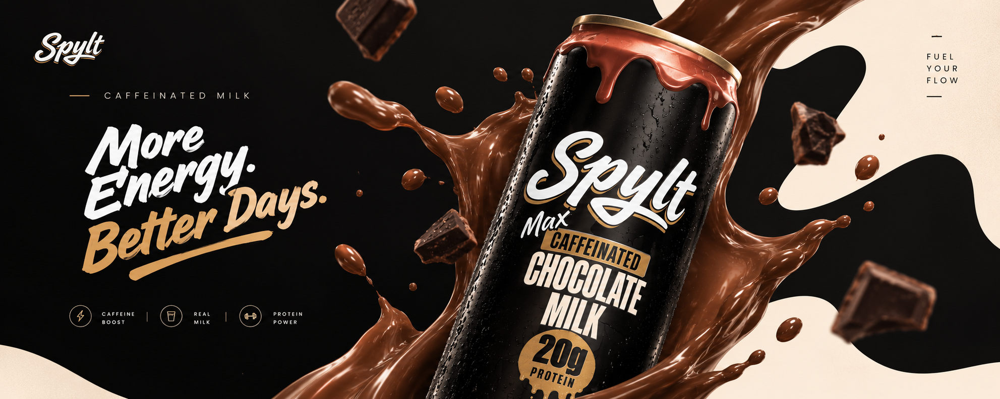

<p align="center"></p>

# SPYLT

[](https://vite.dev/)
[](https://react.dev/)
[](https://www.typescriptlang.org/)
[](https://tailwindcss.com/)
[](https://gsap.com/)
[](https://ui.shadcn.com/)

A responsive, animation-rich landing page for SPYLT, a playful protein and caffeine drink brand. The page introduces the product, showcases its flavors and nutrition, highlights benefits, and closes with video testimonials.

## Getting started

You’ll need a recent version of Node.js and a package manager. This repository includes a `bun.lock`; Bun is the simplest option, though npm works too.

```bash
bun install
bun run dev
```

Open the local URL printed by Vite (usually `http://localhost:5173`). With npm, use `npm install` followed by `npm run dev`.

## Available commands

| Command | Description |
| --- | --- |
| `bun run dev` | Start the Vite development server. |
| `bun run build` | Type-check the app and create a production build in `dist/`. |
| `bun run preview` | Serve the production build locally. Run the build first. |
| `bun run lint` | Check the project with ESLint. |
| `bun run format` | Format project files with Prettier. |

Use `npm run <command>` instead if you installed dependencies with npm.

## What’s in the app

- **Hero and loading screen** — Shows a progress screen while key hero media loads, then reveals the landing page. Larger screens use a video background; smaller screens use images.
- **Brand story** — Animated messaging introduces the SPYLT tone and product.
- **Flavor showcase** — A slider presents the drink flavors.
- **Nutrition and benefits** — Highlights nutrition details and product benefits.
- **Testimonials** — Video cards play on hover.
- **Navigation and footer** — Connect the page sections and social links.

The page is assembled in [`src/App.tsx`](src/App.tsx). Its content is split into components under `src/components/`, with product copy and display data in `src/lib/constants.ts`.

## Project layout

```text
src/
  components/       Page sections, navigation, shared UI, and animations
  lib/              Shared content and utilities
  App.tsx           Page composition and loading experience
  index.css         Global styles and theme
public/
  images/           Product, flavor, and interface imagery
  videos/           Hero, flavor, and testimonial videos
  fonts/            Local font assets
```

Static media is served from `public/` and referenced with root-relative paths such as `/images/hero-img.webp`. When replacing an asset, keep its path in sync with the component that uses it. The hero loader expects `/videos/hero-bg.mp4` on desktop and `/images/hero-bg.webp` plus `/images/hero-img.webp` on mobile.

## Notes

This is a front-end showcase; it does not include a backend or purchase flow. The document title, description, social sharing metadata, and sitemap link are configured in [`index.html`](index.html).
